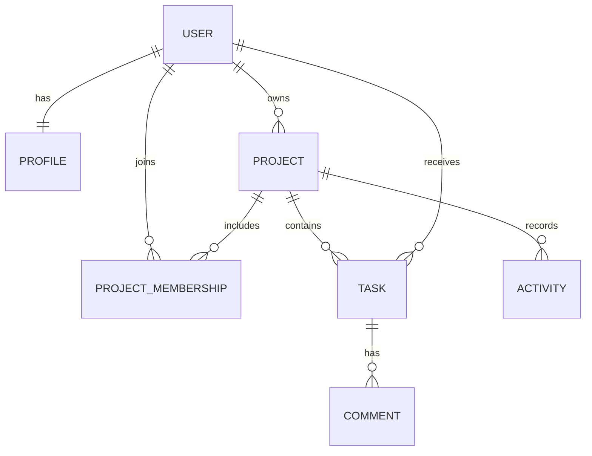

# DevBoard

DevBoard is a collaborative project and task management application built with Django. It helps small teams organize work, define responsibilities, monitor deadlines, and keep a clear activity history in one place.

> This repository began as my first Django “Hello, world” project. I rebuilt it as a production-oriented portfolio project to demonstrate how my backend and software-design skills evolved.

## Features

- User registration, authentication, profiles, and password changes.
- Projects with owner, collaborator, and viewer roles.
- Kanban-style board with task status, priority, assignee, and due date.
- Object-level authorization for projects and tasks.
- Task discussions and project activity history.
- Dashboard with workload, overdue items, progress, and charts.
- Search, filtering, pagination, responsive design, and dark mode.
- Customized Django administration.
- Demo-data command, automated tests, continuous integration, and Docker support.

## Tech stack

- Python 3.13
- Django 5.2 LTS
- PostgreSQL in production / SQLite for local development
- Django templates, Bootstrap 5, and Chart.js
- WhiteNoise and Gunicorn
- Docker and GitHub Actions

## Architecture

```text
apps/
├── accounts/   # Registration and user profiles
├── core/       # Landing page, dashboard, and demo command
├── projects/   # Projects, memberships, and role permissions
└── tasks/      # Tasks, comments, and activity history
config/         # Environment-specific Django configuration
templates/      # Server-rendered UI
static/         # Application CSS and JavaScript
```

The project follows a modular monolith structure. Each domain owns its models, forms, views, URLs, administration, migrations, and tests. Authorization is enforced on the server for every project-scoped operation.

## Data model



Project access is resolved through memberships. Owners and collaborators can modify tasks; viewers have read and comment access. Owner-only operations include project configuration and member administration.

## Local setup

### Windows PowerShell

```powershell
python -m venv .venv
.\.venv\Scripts\Activate.ps1
pip install -r requirements.txt
Copy-Item .env.example .env
python manage.py migrate
python manage.py seed_demo
python manage.py runserver
```

### macOS or Linux

```bash
python -m venv .venv
source .venv/bin/activate
pip install -r requirements.txt
cp .env.example .env
python manage.py migrate
python manage.py seed_demo
python manage.py runserver
```

Open `http://127.0.0.1:8000` and use the optional demo account:

- Username: `demo`
- Password: `DevBoard2026!`

## Running tests

```bash
pip install -r requirements-dev.txt
python manage.py check
python manage.py makemigrations --check --dry-run
coverage run manage.py test
coverage report
```

The GitHub Actions workflow runs configuration checks, migration checks, tests, and enforces a minimum coverage threshold on every push and pull request.

## Docker

Create `.env` from `.env.example`, then run:

```bash
docker compose up --build
```

The containerized environment uses PostgreSQL and exposes the application at `http://localhost:8000`.

## Security and configuration

Secrets and environment-specific values are loaded from `.env`, which is excluded from version control. Production deployments must provide a unique `SECRET_KEY`, disable `DEBUG`, define exact allowed hosts and trusted origins, and enable secure cookies over HTTPS.

Before deployment:

```bash
python manage.py check --deploy
```

## Roadmap

- REST API with Django REST Framework.
- Drag-and-drop status updates.
- Email invitations and notifications.
- File attachments with cloud storage.

## Author

Developed by **Yanxmarcos Chan Vásquez** as a Django portfolio project.

## License

This project is available under the MIT License.
